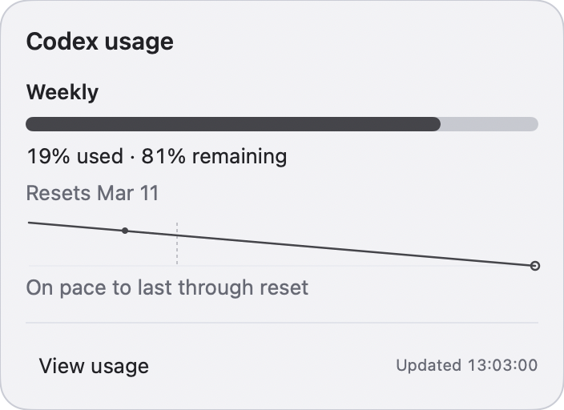
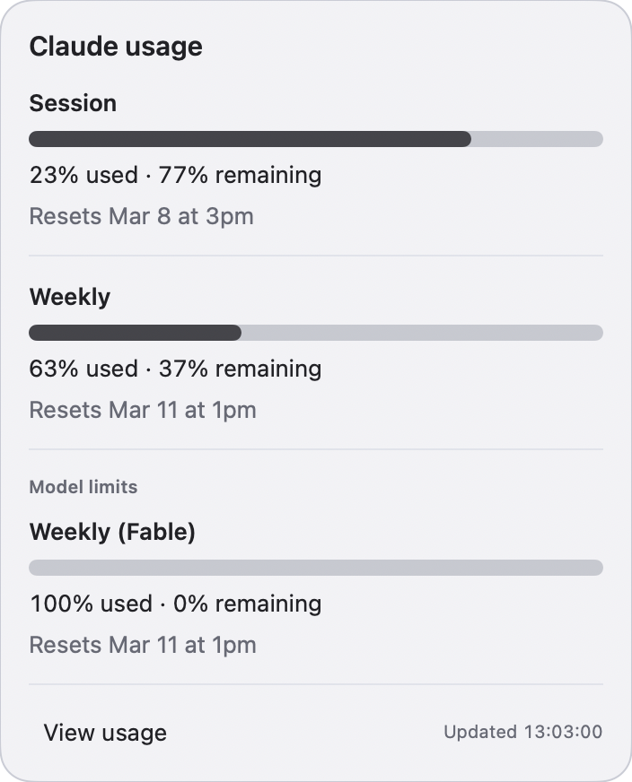
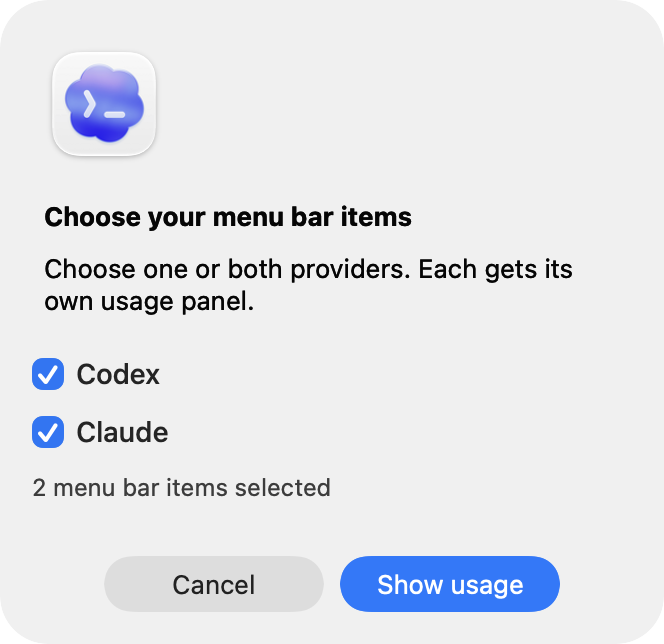
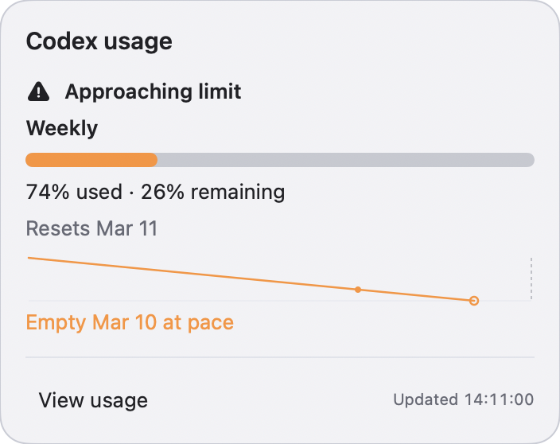
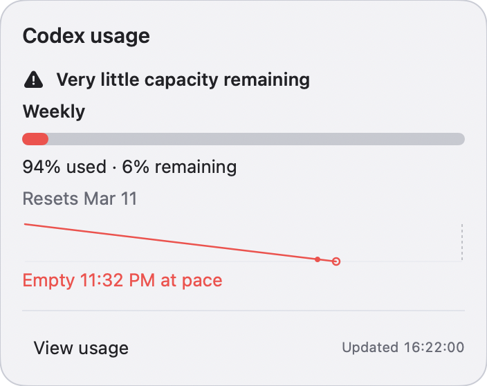
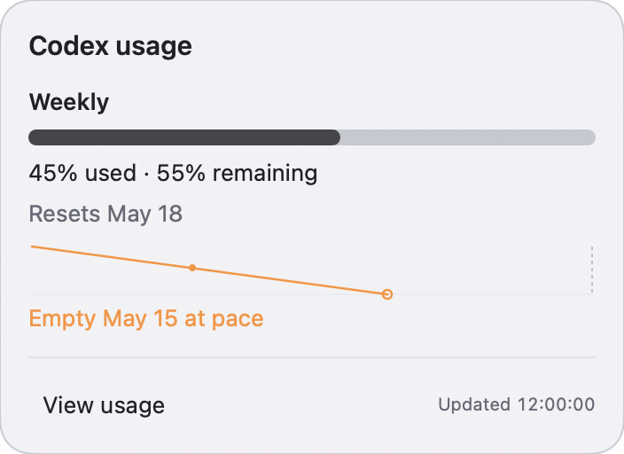
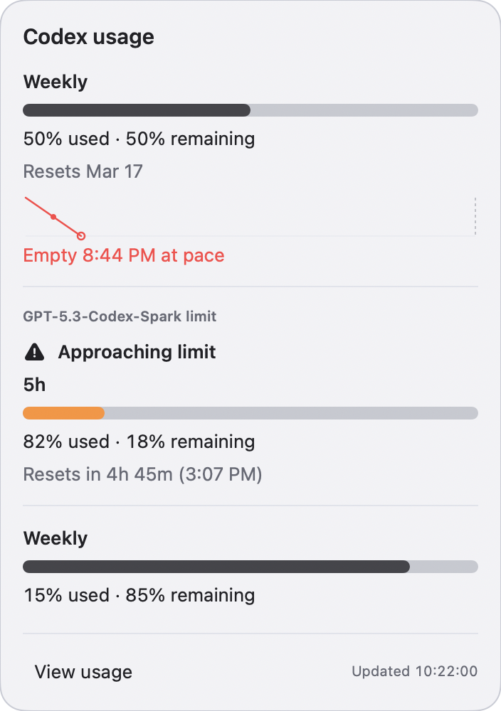

# CodexToolbar

Codex and Claude usage, in your menu bar. Choose either provider or both, with a separate menu bar item and usage panel for each.

<picture>
  <source media="(prefers-color-scheme: dark)" srcset="screenshots/providers-dark-status-item.png">
  
</picture>

Click either item to check remaining usage, reset timing, and that provider's usage dashboard.

| Codex | Claude |
| --- | --- |
| <picture><source media="(prefers-color-scheme: dark)" srcset="screenshots/readme-normal-dark-popover.png"></picture> | <picture><source media="(prefers-color-scheme: dark)" srcset="screenshots/readme-claude-dark-popover.png"></picture> |

Usage screenshots show the v0.1.21 interface with fixed sample values. Images follow your light or dark theme. Available limits depend on your account.

## What It Does

- Shows each provider's most constrained core usage window as a compact progress bar in the menu bar.
- Shows used/remaining percentages, progress bars, and reset timing in each provider's panel.
- Reads Codex limits, including multi-week windows, and projects whether usage will run out before reset from the current 5h and Weekly pace.
- Reads Claude subscription limits: session, weekly, and model-specific weekly usage, using your signed-in Claude Code CLI.
- Opens the corresponding usage dashboard with `View usage` in either panel.
- Refreshes Codex automatically on system clock minute boundaries and Claude every five minutes. Right-click either item for `Refresh now`.
- Offers optional Codex Spark limits and organization-level OpenAI API usage. API usage requires enabling the view and configuring an `OPENAI_ADMIN_KEY`.
- Remembers your provider selection and supports launch at login.

## Requirements

- macOS 14 or later.
- **For Codex:** Codex CLI installed locally and signed in on the same Mac.
- **For Claude:** a current Claude Code CLI, signed in with a Claude subscription.

You only need the CLI for the provider you choose. To display both providers, install and sign in to both CLIs.

## Install

### Download DMG

[Download the latest DMG from GitHub Releases](https://github.com/mikeylong/codex-toolbar/releases/latest)

Open the DMG, drag `CodexToolbar.app` into `Applications`, and launch it from there. Select Codex, Claude, or both when the provider chooser appears, then click `Show usage`.

### Build from source

Source builds require Xcode Command Line Tools or a full Swift toolchain.

```bash
git clone https://github.com/mikeylong/codex-toolbar.git
cd codex-toolbar
./scripts/install_app.sh
```

That installs `CodexToolbar.app` to `~/Applications` and opens it.

## Uninstall

```bash
./scripts/uninstall_app.sh
```

That quits `CodexToolbar` if it is running, removes its launch-at-login registration, and deletes `~/Applications/CodexToolbar.app`.

## Choose providers

Select either provider or both using the visible checkboxes. Your choice is remembered. Right-click either menu bar item and select `Choose providers…` to change it later.

<picture>
  <source media="(prefers-color-scheme: dark)" srcset="screenshots/provider-chooser-dark.png">
  
</picture>

## Use

- Left-click a provider's menu bar item to see its usage panel. With both enabled, the Codex mark and Claude asterisk identify the two items.
- Use `View usage` in either panel to open that provider's usage dashboard. `Open Codex` is available in Codex's right-click menu when the desktop app is installed locally.
- Install a current Claude Code CLI and sign in with `claude auth login` first. The integration was verified with Claude Code 2.1.326; older versions may return only session cost and will show limits as unavailable.
- Each item's `Refresh now` refreshes its own provider. Codex-specific API, credit, and Spark options appear only in the Codex menu. Launch at login, provider selection, and Quit apply to the app.
- Enable `Show API usage` from the Codex right-click menu, then use the OpenAI API usage section after configuring an `OPENAI_ADMIN_KEY`.
- Use `Launch at login` after running the installed app from `Applications`.

## More Codex examples

<details>
<summary>Warning, critical, projection, and Spark screenshots</summary>

These v0.1.21 examples use fixed sample values. Spark adds separately labeled 5h and Weekly windows when available for your account.

| Example | Preview |
| --- | --- |
| Warning | <picture><source media="(prefers-color-scheme: dark)" srcset="screenshots/readme-warning-dark-popover.png"></picture> |
| Critical | <picture><source media="(prefers-color-scheme: dark)" srcset="screenshots/readme-critical-dark-popover.png"></picture> |
| Projection | <picture><source media="(prefers-color-scheme: dark)" srcset="screenshots/readme-projection-dark-popover.png"></picture> |
| Spark | <picture><source media="(prefers-color-scheme: dark)" srcset="screenshots/readme-spark-dark-popover.png"></picture> |

</details>

## Notes

- The app launches its own `codex app-server` subprocess. You do not need to keep an interactive Codex CLI session open.
- The displayed percentages in the popover are remaining percentages, matching the Codex UI.
- Window labels in the popover follow Codex UI display conventions first, with near-whole hour/day/week payload values normalized as a fallback.
- Codex auto-refresh syncs to system clock minute boundaries, so its numbers update at the start of each minute unless you refresh manually from the right-click menu.
- Claude usage refreshes independently every five minutes while enabled, on manual refresh, and when opening its stale popover. Its panel shows remaining percentages, Claude's reset descriptions, and its own update time. Its menu bar indicator reflects the most constrained session/all-model weekly limit; model-specific limits such as Fable remain separately labeled in the panel. Unavailable or stale Claude data is marked instead of displaying an old bar as current.
- Claude runs the built-in `/usage` command in noninteractive JSON mode with tools, hooks, MCP servers, session persistence, and auto-updates disabled for the probe. The app uses Claude's existing sign-in; it does not read or store Claude tokens. Only quota rows are displayed; local usage insights are neither displayed nor saved. No model prompt is sent.

## Development

Quit the running toolbar before generating screenshots so its menu bar items do not overlap the sample items. The chooser capture uses the production native controls on a solid background for legibility.

```bash
swift test
./scripts/build_app.sh
open dist/CodexToolbar.app
./scripts/build_dmg.sh
./scripts/generate_screenshots.sh
./scripts/smoke_test_install.sh
```

GitHub Actions runs `swift test` plus the installed-app smoke test on macOS for pull requests and pushes to `main`.
Tagged releases also build and upload a signed DMG to GitHub Releases.

Release rule:
- Ship annotated git tags that match `Resources/Info.plist` `CFBundleShortVersionString`, for example `v0.1.10`.
- GitHub release DMGs must be signed with a real `Developer ID Application` identity and stapled after notarization. An ad hoc DMG will trigger the macOS "Apple could not verify it is free of malware" warning when downloaded from GitHub.
- The `Release DMG` workflow expects these repository secrets before a tag is published: `MACOS_DEVELOPER_ID_APPLICATION_P12`, `MACOS_DEVELOPER_ID_APPLICATION_P12_PASSWORD`, `MACOS_BUILD_KEYCHAIN_PASSWORD`, `MACOS_DEVELOPER_ID_APPLICATION_IDENTITY`, `APPLE_API_KEY_P8`, and `APPLE_API_KEY_ID`.
- `APPLE_API_ISSUER_ID` is optional. Set it for a team App Store Connect API key; leave it unset for an individual key.

Local notarized DMG setup:
- Save the App Store Connect API key to disk, for example `~/.keys/AuthKey_<KEY_ID>.p8`, with `chmod 600`.
- Create a reusable local notary profile:

```bash
xcrun notarytool store-credentials codextoolbar-notary \
  --key ~/.keys/AuthKey_<KEY_ID>.p8 \
  --key-id <KEY_ID> \
  --issuer <ISSUER_UUID> \
  --validate
```

- Build and verify a notarized DMG using the installed Developer ID identity:

```bash
CODE_SIGN_IDENTITY='Developer ID Application: Michael Long (2468833C5L)' \
NOTARYTOOL_KEYCHAIN_PROFILE='codextoolbar-notary' \
REQUIRE_DISTRIBUTION_SIGNING=true \
VERIFY_DMG_AFTER_BUILD=true \
./scripts/build_dmg.sh
```

## Troubleshooting

If another app's **Allow in the Menu Bar** toggle hides CodexToolbar while CodexToolbar's own toggle has no effect, macOS may have cached the toolbar's menu item under the app that launched it during development. Inspect the cached ownership with:

```bash
python3 scripts/repair_menu_bar_ownership.py
```

Close System Settings, then apply the previewed repair with `python3 scripts/repair_menu_bar_ownership.py --apply`. This backs up the records under `dist/menu-bar-ownership/`, removes CodexToolbar's bundle reference from other apps' records, and associates it with CodexToolbar's own record. It preserves all visibility choices and unrelated references, then restarts Control Center and, on macOS 27 and later, MenuBarAgent to reload the records. The preference format is undocumented; the script refuses unfamiliar data. Reopen System Settings → Menu Bar and check both toggles afterward.

On macOS 26 and later, every UI launch hands off to a fresh LaunchServices instance before SwiftUI or the status item starts. This includes direct launches of the bundled executable from an IDE, agent, or screenshot script. The installer and updater continue to open the app bundle. Maintenance commands run in place without creating UI; screenshot and terminating diagnostic launches preserve their settings and wait for completion. Bare `swift run CodexToolbar` launches are rejected: build and open the app bundle instead. Existing cached ownership mistakes still require the repair above. Older macOS versions keep their existing bundled launch behavior.

If you move or rename the repo and building stops with an error like `PCH was compiled with module cache path ...` plus `missing required module 'SwiftShims'`, clear the stale Swift module cache and rebuild:

```bash
swift package clean
./scripts/build_app.sh
open dist/CodexToolbar.app
```

`./scripts/build_app.sh` and `./scripts/install_app.sh` automatically retry once after `swift package clean` when they detect this specific cache-mismatch failure.

## Fresh Install Smoke Test

Run this from a clean local macOS user account to validate the documented install flow:

```bash
./scripts/smoke_test_install.sh
```

Expected passing outcomes:
- the app installs to `~/Applications`
- the installed app launches successfully
- startup reaches either live ready state, `Codex CLI not found.`, `Sign in to Codex to view rate limits.`, or `No rate-limit data available.`

`Launch at login` should be validated only after the installed app is running from `~/Applications`.
